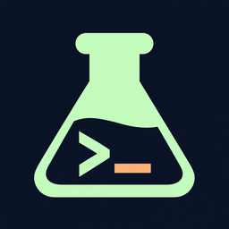

# Activity Lab

Activity Lab simulates editing in Visual Studio Code. Each session opens its own scratch files, writes samples in the selected languages and saves a local report when it ends.

## Install

In VS Code 1.85 or later, open **Extensions**, choose **Install from VSIX** from the menu and select `activity-lab-synthetic-4.1.1.vsix`. The installer is in the release kit. VS Code includes the runtime the extension needs.

## Start a session

Run **Activity Lab: Start Session** from the Command Palette. Choose a language source, enter an optional project name and select the duration, edit pattern, interval and typing style. Review the settings and choose **Start session**. 

(CAUCTION! if you use the typing animaiton or something like character by character (not instant) you may get flagged in one of THOSE provider can getting like "public profile stats made private because tailing log file(s)" so becareful with that option, but the rest of it it's fine.

| Language source | What it does |
| --- | --- |
| Single language | Keeps one of the 141 built-in language and file profiles open. |
| Choose multiple language | Lets you select any number of built-in profiles. Each profile gets one turn per shuffled round. |
| Saved Language | Opens a named selection from your VS Code profile. Choose a preset, then **Use preset** or **Delete preset**. |
| Professional Modes | Groups 44 roles by field. Each row has a role icon and lists the profiles in rotation order. |
| WakaTime language catalog | Looks up a public catalog entry online. For an unfamiliar format, choose the extension and editor grammar. |
| Custom language | Uses a file extension and an installed editor grammar of your choice. |

After selecting two or more profiles, choose **Use once** to continue or **Save preset** to name the selection. Saved presets remain available after you restart VS Code. A single selection goes straight to session setup.

## Editing

**Instant** applies a batch in one edit and is the default. **Character by character** types the new text with small variations in timing. Both styles use the same samples and counters. A session takes one editing step at a time.

| Edit pattern | Added per step | Removed from the current file |
| --- | ---: | --- |
| Balanced (1:1) | 4 | Up to 4 earlier lines |
| Steady growth (4:1) | 4 | 1 earlier line when available |
| Fast growth (8:1) | 8 | 1 earlier line when available |

A line counts once even when typed in several keystrokes. JSON profiles count entries, and Whitespace counts instruction samples. These units keep structured samples intact. Each profile gets its own file, so its first step only adds content.

Choose an interval of 15, 30, 60 or 120 seconds. Timed sessions run for up to eight hours. **Until stopped** keeps the session open until you stop it, close the extension host or reach a file limit. Short sessions can end partway through a language rotation.

## Files and reports

Run **Activity Lab: Show Status** for the current language and session folder. Click **Activity Lab** in the status bar or run **Activity Lab: Stop Session** to finish.

| Location | Contents |
| --- | --- |
| `~/.vscode-activity-lab/` on Linux or `%USERPROFILE%\.vscode-activity-lab\` on Windows | A separate directory for each session. |
| `.wakatime-project` | The project name you entered. The default is `Activity Lab`. |
| `ABOUT_THIS_SESSION.txt` | A note identifying the files as generated examples. |
| `session-report.json` | Selected profiles, filenames, local change counts, typing style and elapsed time. |

Sessions stop if Activity Lab detects a manual edit, if a file exceeds 2 MB or if session files exceed 10 MB. Remove old session folders yourself when you have finished with their reports.

Only the online catalog makes a network request. Activity Lab does not request tracker credentials or send heartbeats. The report describes generated edits. External services decide which editor events they record. [Project labels and tracker statistics](docs/PROJECTS_AND_STATISTICS.md)

## Develop

Run the following commands from the source directory. Tests use Node.js 18 or later. Packaging uses Python 3.8 or later, available as `python`, or run `python3 scripts/build.py` directly.

```sh
npm run check
npm test
npm run build
```

The build writes the current installer to `release/`. The project uses JavaScript directly and has no third-party runtime dependencies.

[Getting started](docs/GETTING_STARTED.md)

[Troubleshooting](docs/TROUBLESHOOTING.md)

[Publishing releases and packages](docs/GITHUB_RELEASE_GUIDE.md)

[Changelog](CHANGELOG.md)

[Contributing](CONTRIBUTING.md)
